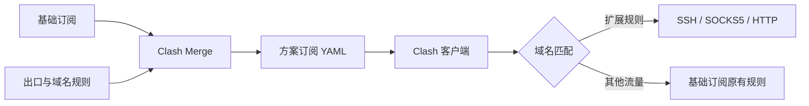

# Clash Merge

**一个默认订阅，多个扩展出口，一处管理。**


Clash Merge 是运行在本机的订阅工作台。保留基础订阅的节点与网络配置，按域名添加 SSH、SOCKS5 或 HTTP 出口，生成可供 Clash 客户端导入的合并订阅。

适合同时使用公网订阅、内网隧道和其他代理出口的场景。新安装从空方案开始，不预置个人服务器、域名或凭据。

> 工作台：`http://127.0.0.1:18790/` · 默认订阅：`http://127.0.0.1:18790/clash.yaml`

[快速开始](#快速开始) · [方案与路由](#方案与路由) · [SSH 守护](#ssh-守护) · [常驻运行](#常驻运行) · [Agent 接入](#agent-接入) · [常见问题](#常见问题)

## 功能一览

| 能力 | 说明 |
| --- | --- |
| 多方案 | 独立来源、出口、域名规则和订阅地址 |
| 多出口 | SSH、SOCKS5、HTTP；后两者支持代理认证 |
| 域名路由 | 后缀匹配、批量编辑、搜索分页与优先级调整 |
| 来源管理 | HTTP(S) URL 或本机 Clash Verge 远程配置 |
| 流量信息 | 上游用量、剩余额度、总额度与到期时间 |
| SSH 守护 | 自动启动、断线重试、启停与重连 |
| 进程诊断 | 端口状态、外部进程名称与 PID |
| 输出管理 | YAML 预览、下载和订阅地址复制 |
| Agent 操作 | Skill、API 文档与一键复制接入信息 |
| 本机访问 | 实际来源、Host 与写操作 Origin 检查 |

## 快速开始

建议使用 Node.js 24 LTS 和 npm。SSH 出口需要 `/usr/bin/ssh`，外部进程信息检查使用 `lsof`。默认 Clash Verge 数据目录按 macOS 配置，其他目录可通过环境变量指定。

```bash
git clone git@github.com:abandon1a2b/clash-merge.git
cd clash-merge
npm ci
npm start
```

打开 `http://127.0.0.1:18790/`，然后：

1. 编辑默认订阅，填写自己的 URL 或选择已有远程配置。
2. 添加出口，填写连接参数和需要走该出口的域名。
3. 保存配置，检查订阅刷新与出口状态。
4. 将方案订阅地址导入 Clash 客户端。
5. 后续修改保存后，在客户端更新该订阅。

没有扩展出口时，保留基础订阅行为。自定义 URL 模式无需本机 Clash 配置。

## 方案与路由



| 订阅地址 | 行为 |
| --- | --- |
| `/subscriptions/<plan-id>/clash.yaml` | 固定对应一个方案，推荐日常使用 |
| `/clash.yaml` | 默认方案别名，随默认方案选择变化 |

默认方案的两个地址返回相同配置，不需要重复导入。

### 合并规则

- 保留基础订阅的节点、代理组、DNS、TUN 和其他网络设置。
- 直连避让规则置于最前，然后是扩展域名规则，再接基础订阅规则。
- `team.example` 同时匹配其子域名。重叠后缀按出口顺序匹配。
- 同一方案的多个启用出口不能配置完全相同的域名。
- 出口断开时，其域名流量不会自动切回基础订阅。
- 最多 20 个方案、每方案 30 个出口、每出口 500 个域名输入。

### 流量与到期时间

上游提供有效的 `Subscription-Userinfo` 响应头时，合并订阅的 GET/HEAD 响应会携带对应信息，工作台也会显示用量和到期时间。

这些数字代表**基础订阅额度**，不包含扩展出口用量。刷新失败时保留最近一次成功数据；切换来源后清除旧数据。上游没有该响应头时不显示额度。数据缓存在内存中，服务重启后需要重新取得。

## SSH 守护

每个出口使用两跳 SSH，同一把本地私钥用于两跳认证：


配置中继地址、用户、目标用户、私钥路径和本地 SOCKS 端口。高级参数包含中继 SSH 端口、远端转发端口和本地转发端口。远端链路需提前准备，本项目不部署远端服务。

| 情况 | 行为 |
| --- | --- |
| 服务启动，SSH 出口已启用 | 自动尝试启动守护 |
| 本地端口已被占用 | 保留外部进程，不接管 |
| 受管隧道断开 | 10 秒后重试 |
| 修改连接、停用或删除受管出口 | 必须先停止对应守护 |
| 服务退出 | 清理本服务创建的 SSH 进程 |

已启用 SSH 出口的两个本地端口必须在所有方案间保持唯一。主机密钥校验保持严格，首次连接前需自行配置 SSH 信任。私钥只使用本地路径，不上传其内容。

> “守护运行中”和“端口已监听”不等于目标业务可达。实际端到端连通性目前显示“未验证”。外部诊断记录也不是外部 SSH 原始日志。

## 常驻运行

可交给 Rooster 等进程管理器运行。先执行 `npm run build`，再创建常驻任务：

| 配置 | 推荐值 |
| --- | --- |
| 命令模式 | `exec` |
| 命令 | 本机 Node 可执行文件的绝对路径 |
| 参数 | `server.js` |
| 工作目录 | 项目绝对路径 |
| 重启策略 | `always` |
| 连续失败上限 | 按需设置，例如 10 |
| 页面链接 | `http://127.0.0.1:18790/` |

不要同时运行开发服务与常驻任务占用同一端口。电脑需保持唤醒，进程管理器需保持运行。

### 开发与更新

| 命令 | 用途 |
| --- | --- |
| `npm run dev` | 构建页面，以 Node watch 运行后端 |
| `npm run build` | 生成 `public/app/` 页面产物 |
| `npm start` | 构建后以普通 Node 进程运行 |
| `npm test` | 后端回归和集成测试 |

开发命令不持续监听前端，修改页面后需要重新 build。普通 `node server.js` 不自动重载源码，但 build 会覆盖正在提供的页面文件。

为了开发时不影响服务，请使用独立 checkout/worktree 和预览端口。部署顺序：**合并代码到运行目录 → 构建 → 重启对应服务任务 → 刷新网页及客户端订阅**。只 build 不会自动合并其他分支。

## Agent 接入

点击工作台右上角机器人图标，可打开文档、复制地址或复制完整接入信息。

```bash
# 操作流程（Markdown）
curl -fsS http://127.0.0.1:18790/api/skill

# 接口与配置定义（JSON）
curl -fsS http://127.0.0.1:18790/api/docs

# 默认方案健康状态
curl -fsS http://127.0.0.1:18790/health
```

Agent 应先读取 Skill，再读取 API 文档。修改配置时保留读取响应的 `ETag`，通过 `If-Match` 提交完整文档。遇到 409 后重新读取并合并修改意图，避免覆盖其他页面的更改。

### API 速查

| 方法 | 路径 | 用途 |
| --- | --- | --- |
| GET | `/api/skill`、`/api/docs` | 操作流程与接口说明 |
| GET / PUT | `/api/settings` | 读取 / 保存完整配置 |
| GET | `/api/profiles`、`/api/defaults` | 可用来源与默认参数 |
| GET | `/api/plans/<id>/health` | 刷新、缓存及流量状态 |
| POST | `/api/plans/<id>/refresh` | 刷新基础订阅 |
| GET | `/api/plans/<id>/preview` | 已保存配置的生成结果 |
| GET | `/api/plans/<id>/exits` | 出口状态、日志和进程诊断 |
| POST | `/api/plans/<id>/exits/<exit-id>/start` | 启动守护 |
| POST | `/api/plans/<id>/exits/<exit-id>/stop` | 停止守护 |
| POST | `/api/plans/<id>/exits/<exit-id>/restart` | 重连守护 |
| GET / HEAD | `/subscriptions/<id>/clash.yaml` | 指定方案订阅 |
| GET / HEAD | `/clash.yaml` | 默认方案订阅 |
| GET / POST | `/health` / `/refresh` | 默认方案健康检查 / 刷新 |

## 环境变量

| 变量 | 默认值 | 说明 |
| --- | --- | --- |
| `CLASH_MERGE_PORT` | `18790` | 服务端口，1024–65535 |
| `CLASH_MERGE_REFRESH_MINUTES` | `60` | 刷新间隔，至少 5 分钟 |
| `CLASH_VERGE_DIR` | macOS Clash Verge 数据目录 | 本机配置来源目录 |

```bash
CLASH_MERGE_PORT=18792 CLASH_MERGE_REFRESH_MINUTES=30 npm start
```

## 本地数据与访问边界

- 配置位于 `data/settings.json`，权限为仅所有者可读写。
- 旧版扁平配置自动迁移，备份为 `data/settings.json.v1-backup`；不修改 Clash 原始文件。
- 配置、环境文件、私钥、日志、截图、依赖和构建产物被 Git 忽略，不要强制加入仓库。
- 设置、预览和 YAML 可能包含令牌或代理密码，勿将完整响应发布到日志或 issue。
- 仅接受实际回环连接，转发头不能绕过检查；Host 须匹配服务地址，写操作检查 Origin。
- 没有额外登录认证，不要通过反向代理向公网暴露工作台。
- 重定向最多 5 次，每跳检查目标；同服务端口的目标被拒绝，防止域名别名回环。
- 检查静态代理组及 `dialer-proxy` 循环；动态 provider 内容不在检测范围内。

## 常见问题

<details>
<summary><strong>保存后客户端为什么还没有变化？</strong></summary>

保存修改的是服务配置，客户端需要更新导入的合并订阅才会采用新规则。

</details>

<details>
<summary><strong>为什么没有显示流量额度？</strong></summary>

检查基础订阅是否刷新成功，以及上游是否返回有效的 `Subscription-Userinfo` 头。YAML 本身不能推断额度，服务重启后也需要重新获取。

</details>

<details>
<summary><strong>为什么出口显示外部进程？</strong></summary>

本地端口被其他进程监听。本服务不会接管它，可查看诊断详情中的名称和 PID。需要受管守护时，先自行停止原脚本或改用空闲端口。

</details>

<details>
<summary><strong>订阅刷新失败会失去现有配置吗？</strong></summary>

同一来源可回退到已有有效配置。切换来源会清除旧合并缓存，避免混入其他订阅节点或额度。

</details>

<details>
<summary><strong>build 并重启后为什么还是旧页面？</strong></summary>

确认改动已合并到实际运行目录，并在该目录 build。独立分支的代码不会自动进入正式版本。随后重启正确任务并刷新浏览器。

</details>

## 项目结构

```text
web/                 React 工作台与 shadcn/ui 组件
src/app.js           页面、订阅与本机 API
src/agent-docs.js     Agent 流程和接口文档
src/plans.js          方案校验、迁移与持久化
src/runtime.js        多方案缓存和独立出口守护
src/service.js        拉取、重定向检查和缓存回退
src/merge.js          合并、直连避让和循环检查
src/tunnel.js         SSH 生命周期和监听诊断
src/usage.js          订阅流量元数据解析
test/                回归和集成测试
server.js            启动、定时刷新和退出清理
```

`public/app/` 是构建产物，`data/` 是本机私有配置，均不提交。旧版扁平配置模块保留用于兼容和回归测试。
